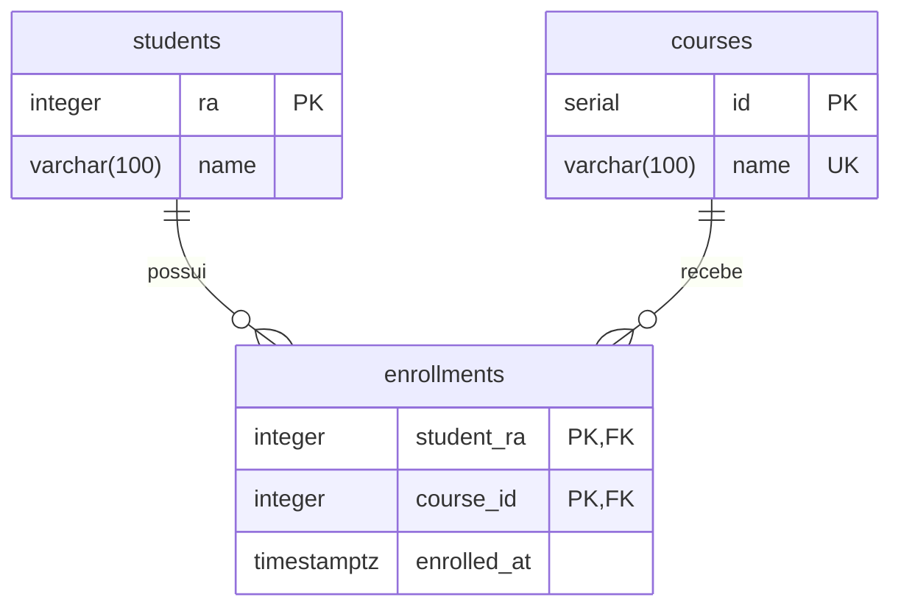

# Aula – API HTTP com recursos e princípios REST

## Descrição

Projeto didático para explorar a comunicação entre cliente e servidor por HTTP. A aplicação permite cadastrar alunos e disciplinas e registrar matrículas, usando uma API em NestJS com Drizzle ORM e PostgreSQL. Uma aplicação de página única (SPA), feita com HTML, CSS e JavaScript, permite enviar requisições e inspecionar as respostas no navegador.

O exemplo demonstra recursos identificados por URLs, representações JSON, métodos HTTP, códigos de status, validação, integridade dos dados, requisições independentes e política de cache. A definição formal de REST também inclui hipermídia (HATEOAS), abordada como conceito na aula e não implementada neste exemplo.

## Estrutura de pastas e arquivos

```text
.
├── .env                           # Configuração utilizada na execução local do projeto
├── .env.example                   # Modelo das variáveis de ambiente
├── .gitignore                     # Arquivos ignorados pelo Git
├── compose.yml                    # Serviços, portas, rede, volume e healthchecks
├── README.md                      # Orientações para a aula
├── database/                      # Banco de dados PostgreSQL
│   ├── Dockerfile                 # Imagem com os scripts de inicialização
│   ├── init.sql                   # Criação das tabelas e restrições
│   └── seed.sql                   # 39 disciplinas, 3 alunos e 22 matrículas
├── front/                         # Cliente HTTP de página única
│   ├── Dockerfile                 # Imagem Nginx para servir a interface
│   ├── nginx.conf                 # Arquivos estáticos e proxy de /api para o servidor
│   ├── index.html                 # Estrutura da tela
│   ├── style.css                  # Estilos e adaptação para telas menores
│   └── app.js                     # Exemplos, envio via Fetch e exibição das respostas
└── server/                        # API HTTP em NestJS
    ├── Dockerfile                 # Compilação e imagem de execução em etapas
    ├── package.json               # Dependências e comandos npm
    ├── package-lock.json          # Versões das dependências
    ├── nest-cli.json              # Configuração da CLI do NestJS
    ├── tsconfig.json              # Configuração do TypeScript
    ├── tsconfig.build.json        # Configuração da compilação
    └── src/                       # Código-fonte da API
        ├── main.ts                # Inicialização, validação, cache e encerramento
        ├── app.module.ts          # Configuração do ambiente e registro dos módulos
        ├── health.controller.ts   # GET /health para verificar a resposta da API
        ├── database/              # Conexão compartilhada e identificação de erros SQL
        │   ├── database.module.ts # Disponibiliza o serviço de banco
        │   ├── database.service.ts # Pool de conexões e integração com Drizzle
        │   ├── unique-violation.ts # Identifica violações de unicidade
        │   └── foreign-key-violation.ts # Identifica violações de chave estrangeira
        └── modules/               # Recursos da aplicação
            ├── students/          # Alunos: controller, service, module, schema e DTOs
            ├── courses/           # Disciplinas: controller, service, module, schema e DTOs
            └── enrollments/       # Matrículas: controller, service, module, schema e DTO
```

Nos módulos de recursos, `*.controller.ts` define as rotas, `*.service.ts` executa as operações, `*.module.ts` registra os componentes, `*.schema.ts` representa as tabelas no Drizzle e `dto/` define os dados aceitos e suas validações.

## Diagrama do banco de dados



Um aluno pode ter várias matrículas, e uma disciplina pode receber vários alunos. A chave primária composta de `enrollments` impede matricular o mesmo aluno duas vezes na mesma disciplina. As chaves estrangeiras impedem referências inexistentes e a exclusão de alunos ou disciplinas com matrículas vinculadas. Nomes de alunos podem se repetir; nomes de disciplinas são únicos.

O seed cadastra Ana Clara em 5 disciplinas, Bruno Henrique em 7 e Camila em 10. A data da matrícula é preenchida automaticamente pelo banco.

## Como reproduzir o exemplo

### 1. Preparar o ambiente

Instale o Docker com suporte ao Docker Compose e mantenha o mecanismo Docker em execução. Execute os comandos na pasta que contém `compose.yml`. Não é necessário instalar Node.js ou PostgreSQL no computador para executar pelo Compose.

Se ainda não houver um `.env`, copie o modelo. No PowerShell:

```powershell
Copy-Item .env.example .env
```

No Bash:

```bash
cp .env.example .env
```

Confira as variáveis do `.env`:

| Variável | Finalidade | Valor do modelo |
| --- | --- | --- |
| `DB_HOST` | Host do banco; no Compose, o servidor usa o serviço `database` | `database` |
| `DB_PORT` | Porta interna do PostgreSQL | `5432` |
| `DB_PORT_HOST` | Porta do banco publicada no computador | `5433` |
| `DB_NAME` | Nome do banco | `postgres` |
| `DB_USER` | Usuário do banco | `postgres` |
| `DB_PASSWORD` | Senha do banco para o exemplo local | `postgres` |
| `SERVER_PORT` | Porta interna da API | `3000` |
| `SERVER_PORT_HOST` | Porta da API publicada no computador | `3002` |
| `FRONT_PORT_HOST` | Porta da interface publicada no computador | `8080` |

O sufixo `_HOST` identifica portas publicadas no computador. Mantenha `DB_PORT=5432`, pois o exemplo usa a porta padrão do PostgreSQL. O Compose traduz as credenciais `DB_*` para as variáveis `POSTGRES_*` exigidas pela imagem do banco.

### 2. Construir e iniciar os contêineres

```bash
docker compose up -d --build
```

Esse comando constrói as imagens, cria e inicia os contêineres. O servidor aguarda o banco ficar saudável; o frontend aguarda o healthcheck do servidor.

Se as imagens já foram construídas com `docker compose build`, use `docker compose up -d`.

Confira o estado e acompanhe os logs:

```bash
docker compose ps
docker compose logs -f server database front
```

Use `Ctrl+C` para sair dos logs; os contêineres continuam em execução.

### 3. Acessar a aplicação

Com as portas do modelo:

| Endereço | Finalidade |
| --- | --- |
| http://localhost:8080 | Interface do laboratório |
| http://localhost:3002/api/students | Consulta direta à API |
| http://localhost:3002/health | Verificação da API: retorna `{"status":"ok"}` |
| `localhost:5433` | Conexão com o banco por uma ferramenta externa |

O endpoint `/health` verifica se a API responde; ele não consulta o banco. Ajuste os endereços caso tenha alterado as portas no `.env`.

O Nginx encaminha as chamadas `/api` da página para o NestJS pela rede do Compose. Mantenha o endereço base da tela como `http://localhost:8080`: assim, página e requisições usam a mesma origem. Abrir o HTML diretamente ou apontar para outra origem pode exigir configuração de CORS na API.

### 4. Encerrar a execução

```bash
docker compose down
```

O volume `aula3_database_data` preserva os dados. `init.sql` e `seed.sql` são executados, nessa ordem, apenas na primeira inicialização de um diretório de dados vazio. Reconstruir as imagens não reaplica esses scripts em um banco existente.

## Explicação sobre a tela

### Painel 01 — Requisição

- **Exemplo de operação:** preenche o formulário com uma chamada de alunos, disciplinas ou matrículas. Há também exemplos de erros HTTP.
- **Endereço base:** origem para a qual a chamada será enviada; por padrão, utiliza o endereço da própria página.
- **Método:** escolhe `GET`, `POST`, `PATCH` ou `DELETE`.
- **Caminho do recurso:** identifica a coleção ou o recurso, como `/api/students/2026001`.
- **Corpo da requisição:** JSON enviado em `POST` e `PATCH`. O campo fica desabilitado para `GET` e `DELETE` neste cliente.
- **Enviar requisição:** executa a chamada. JSON inválido é identificado antes do envio.
- **Requisição preparada:** mostra método, URL e headers definidos pelo cliente. O navegador pode adicionar outros headers.

Selecionar um exemplo apenas preenche o formulário. A chamada acontece ao clicar em **Enviar requisição**. Operações `POST`, `PATCH` e `DELETE` alteram os dados reais do banco.

### Painel 02 — Resposta

- **Status HTTP:** apresenta o código retornado, destacando sucesso ou erro.
- **Metadados:** mostram duração observada pelo cliente, quantidade de bytes do corpo recebido e URL final. O tamanho não representa todo o tráfego HTTP.
- **Headers da resposta:** exibem os cabeçalhos acessíveis ao JavaScript, como `Content-Type` e `Cache-Control`.
- **Corpo da resposta:** mostra o conteúdo recebido, formatando JSON para facilitar a leitura.

As respostas da API incluem `Cache-Control: no-store`, orientando navegadores e proxies a não armazená-las. Os headers exibidos passam pelo proxy Nginx; headers restritos pelo navegador, como `Set-Cookie`, não ficam disponíveis via Fetch.

Respostas `400`, `404` e `409` são respostas HTTP e aparecem com seus headers e corpo. Uma falha de conexão é apresentada separadamente, sem inventar um status HTTP. O cliente limita a espera a 15 segundos.

### Roteiro de teste na aula

1. Escolha **Alunos · listar** e envie a requisição. Observe o status `200`, os headers e o array JSON.
2. Use **Alunos · criar** para cadastrar o RA `2026099`. Observe `201`. Reenvie a chamada para observar `409` por RA duplicado.
3. Busque e atualize esse aluno. Consulte novamente para comparar a representação retornada.
4. Crie uma disciplina e anote o `id` retornado. Substitua o ID `40` dos exemplos de atualização e exclusão pelo valor real: a sequência não garante esse número.
5. Crie uma matrícula usando o RA do aluno e o ID da disciplina criada. Reenvie para observar `409` por matrícula duplicada.
6. Tente excluir o aluno ou a disciplina enquanto a matrícula existe. Observe `409` por conflito com o vínculo.
7. Exclua a matrícula e, em seguida, o aluno e a disciplina de teste.
8. Experimente **Erro 400 · dados inválidos** e **Erro 404 · aluno inexistente**. Compare os corpos e headers com os das respostas de sucesso.

Os exemplos baseados no seed pressupõem que seus registros ainda existem. Se o RA de teste já estiver cadastrado, use outro RA e ajuste as chamadas seguintes.
